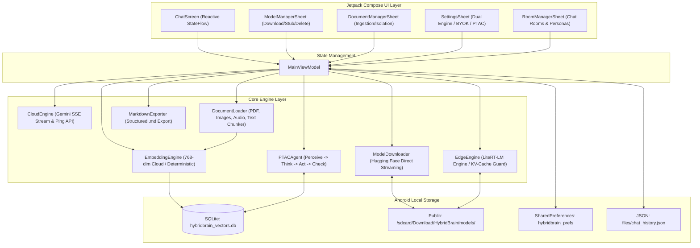

# GEMINI.md — HybridBrain Android Single Source of Truth

> **HybridBrain Android: Multimodal Hybrid AI Workspace (Edge & Cloud)**  
> *Privacy-First Multimodal Second Brain for Android Devices*  
> Powered by **Google AI Edge (LiteRT-LM + Gemma 4)** and **Google Cloud (Gemini 3.8 / 4 via BYOK)**.

---

## 1. Project Vision & Architecture

**HybridBrain Android** is an on-device multimodal intelligent workspace that unifies **Local On-Device AI** (running quantized models locally via Google AI Edge LiteRT) with **Cloud AI** (Gemini 3.8 Flash & Gemini 4 via Google AI Studio BYOK) in a single reactive Jetpack Compose application.

### Why Hybrid AI on Mobile?
1. **Absolute Privacy & Data Sovereignty (Edge AI)**:
   - Sensitive notes, personal documents, and confidential PDFs are processed 100% locally on the phone's CPU/GPU/NPU using **Gemma 4 (E2B-it / QAT 4-bit)** and **EmbeddingGemma 2**.
   - Zero internet bandwidth, zero token API costs, zero data leakage.
2. **High-Reasoning Cloud Synthesis (Cloud AI)**:
   - For web queries, wide-scope multi-step reasoning, or extensive multi-document synthesis, users can toggle to Google AI Studio's **Gemini 3.8 Flash** or **Gemini 4 Argon**.
3. **BYOK (Bring Your Own Key) Security**:
   - The user's Google AI Studio API key is kept secure in local Android storage (`SharedPreferences` / private storage) and is never transmitted to any third-party telemetry server.
4. **Android File Manager Transparency**:
   - Model weights (`.litertlm`) are stored in the device's public `Download/HybridBrain/models/` directory, allowing users to browse, inspect, or manage model files directly within their Android Files application.

---

## 2. Tech Stack & Dependencies

| Component | Technology | Description |
| :--- | :--- | :--- |
| **Language & Platform** | **Kotlin 2.0.21 / Android SDK 35** | Modern idiomatic Kotlin with Coroutines & StateFlow. |
| **UI Framework** | **Jetpack Compose + Material 3** | Adaptive, accessible, mobile-first design complying with `/antislop-ui` and `/antislop-layoutmobile`. |
| **Edge LLM Runtime** | **`com.google.ai.edge.litertlm:litertlm-android`** | Official Google AI Edge runtime for executing quantized Gemma models on-device (`Backend.CPU()`, `Backend.GPU()`, `Backend.NPU()`). |
| **Edge Models** | **Gemma 4 E2B-it (~2.5 GB) & EmbeddingGemma 2 (~740 MB)** | LiteRT-LM open-weight models downloaded directly from Hugging Face public releases. |
| **Agentic RAG Engine** | **PTAC Loop (Google ADK Style)** | Autonomous *Perceive-Think-Act-Check* cycle with step-by-step reflection and anti-hallucination verification. |
| **Vector Database** | **Android SQLite (`SQLiteOpenHelper`)** | Embedded vector store supporting 768-dimensional Cosine Similarity, metadata indexing, and room isolation. |
| **Network & Ingestion** | **OkHttp 4.12.0** | High-performance streaming model download and Gemini SSE streaming. |
| **Multimodal Extractors** | **PdfRenderer / BitmapFactory / MediaMetadataRetriever** | Extracts text and structural metadata from PDF, TXT, MD, Images, and Audio. |
| **Markdown Renderer** | **`com.mikepenz:multiplatform-markdown-renderer-m3`** | AST-based Compose Markdown renderer for live streaming and chat history bubbles. |

---

## 3. Architecture & Data Flow



---

## 4. Key Architectural Safeguards

1. **Context Budgeting & KV-Cache Guard**:
   - The compiled `gemma-4-E2B-it.litertlm` hardware KV-cache is fixed at **4,096 tokens**.
   - `EdgeEngine.kt` enforces a strict context budget: maximum **2 chunks** (~2,200 characters / ~500 tokens) formatted using strict XML delimiters (`<context><document id="1" ...>...</document></context>`).
   - This guarantees that **2,800+ tokens** remain available exclusively for unbroken model responses.
2. **Deterministic SHA-256 Chunk Hashing**:
   - Chunks are hashed using `SHA-256(roomId:sourceName:pageOrPos:start:text[:50])` to prevent duplicate vectors upon re-ingestion.
3. **Room Isolation**:
   - Every chunk is tagged with its `room_id`. Vector searches in Room A cannot retrieve or leak confidential files uploaded to Room B.
4. **Graceful Educational Degradation**:
   - If local weights are missing or the user chooses "Demo Stub", the app streams an informative, contextual fallback simulation without crashing.
5. **Compiler Metadata Flag**:
   - Uses `-Xskip-metadata-version-check` in `build.gradle.kts` to allow seamless interop between Kotlin 2.0.21 and the LiteRT-LM binary release.

---

## 5. Project Directory Structure

```text
HybridBrain/
├── app/
│   ├── build.gradle.kts                 # Android module configuration
│   └── src/main/
│       ├── AndroidManifest.xml          # Storage & Network permissions
│       └── java/com/afrizalmy/hybridbrain/
│           ├── MainActivity.kt          # Compose root activity
│           ├── data/
│           │   ├── local/
│           │   │   ├── VectorDatabaseHelper.kt  # SQLite vector engine
│           │   │   ├── PreferenceManager.kt     # App preferences
│           │   │   └── ChatHistoryManager.kt    # JSON chat history
│           │   └── model/
│           │       └── Models.kt                # Data models & Personas
│           ├── engine/
│           │   ├── ModelDownloader.kt   # Hugging Face direct downloader
│           │   ├── EdgeEngine.kt        # LiteRT-LM Gemma 4 runner
│           │   ├── CloudEngine.kt       # Gemini API client
│           │   ├── EmbeddingEngine.kt   # 768-dim embedding engine
│           │   ├── DocumentLoader.kt    # Multimodal parser & chunker
│           │   ├── PTACAgent.kt         # Autonomous agentic RAG loop
│           │   ├── MarkdownExporter.kt  # Markdown chat export
│           │   └── SystemUtilities.kt   # Hardware diagnostics & auto-routing
│           └── ui/
│               ├── theme/               # Color, Theme, Typography (Material 3)
│               ├── viewmodel/           # MainViewModel
│               └── components/          # ChatScreen, Sheets for Models, Docs, Settings, Rooms
├── gradle/libs.versions.toml            # Version catalog
├── GEMINI.md                            # Single source of truth (this file)
└── README.md                            # Documentation in Indonesian
```
